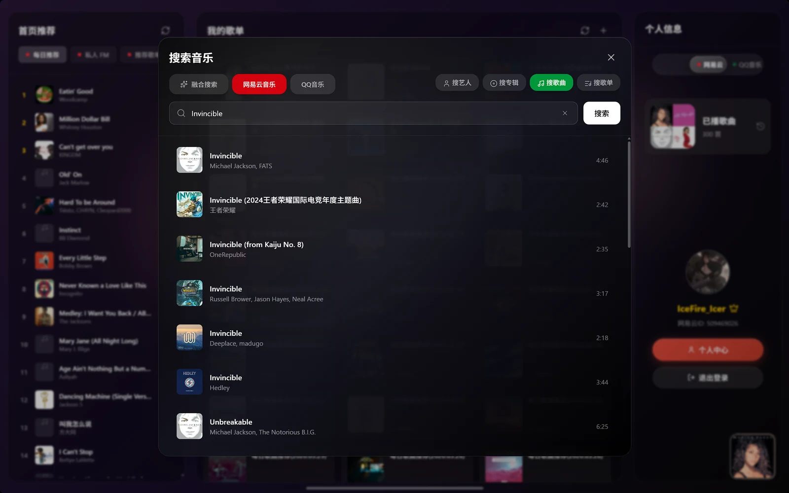
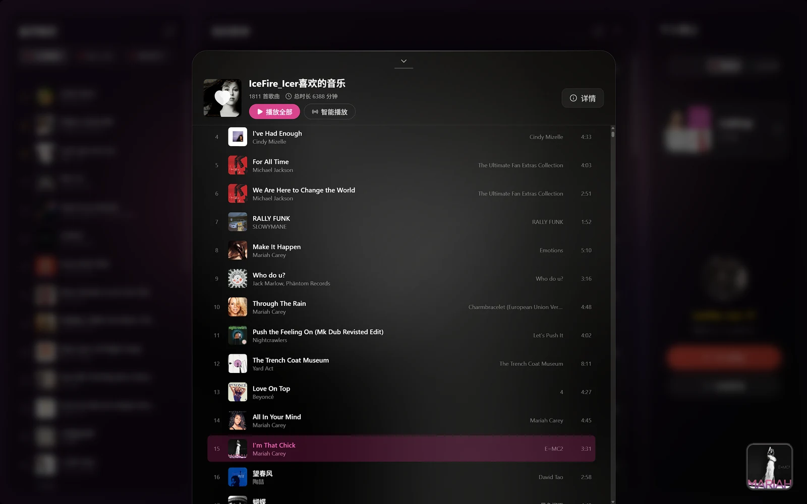

<p align="center">
  
</p>

<h1 align="center">HyperPlayer</h1>

<p align="center"><strong>把音乐放在眼前，把其他留在身后。</strong></p>
<p align="center">面向 Windows 的沉浸式桌面音乐播放器<br>网易云音乐 · QQ 音乐 · B 站看歌</p>

<p align="center">
  <a href="https://github.com/SoundFieldLab/HyperPlayer/releases"><strong>下载 Windows 版</strong></a> ·
  <a href="#体验一览">体验一览</a> ·
  <a href="#本地开发">本地开发</a> ·
  <a href="https://github.com/SoundFieldLab/HyperPlayer/issues">反馈问题</a>
</p>


<p align="center"><sub>封面、歌词、波形，在同一个画面里。让一首歌拥有自己的空间。</sub></p>

---

## 体验一览

**找歌、听歌、看歌，再到调整声音。** HyperPlayer 把这些体验放进同一个窗口，也给不同的听歌习惯留了不同的界面。

| 音乐入口 | 歌词与画面 | 声音与桌面 |
| :--- | :--- | :--- |
| 网易云 / QQ 搜索与推荐 | 逐字点亮、翻译与罗马音 | HSE 调音室与空间音频 |
| 歌单、私人 FM、个人中心 | 现代 / 沉浸 / 看歌 / PV | 交叉淡化、gapless 与专辑无缝 |
| B 站 MV / 视频看歌 | 封面模糊背景与背景律动 | 桌面小组件、独立播放器与桌面歌词 |

### 每一句歌词，都有自己的位置

大字歌词把注意力留在当下；逐词点亮、柔和过渡与弹簧滚动，让歌词跟着演唱展开。也可以切换到现代、看歌或 PV 模式，换一种方式感受同一首歌。


- **不只显示歌词**：支持逐字时间轴、点击跳转、翻译与罗马音。
- **让不同声部可见**：支持 TTML 对唱着色，逐字数据来自平台与 AMLL TTML DB。
- **从听歌到看歌**：B 站看歌支持 MV / 视频、弹幕、互动面板与 MV 背景。

> 歌词效果取决于曲目的时间轴与数据完整度；部分歌曲可能没有逐字歌词、翻译或第三方歌词。Apple 风格动画是歌词侧特性，不代表支持 Apple Music 音源。

### 熟悉的歌单，和下一首惊喜

网易云音乐与 QQ 音乐的搜索、推荐和歌单入口集中在一起。知道想听什么，就直接搜索；还没决定，就从每日推荐、私人 FM 和探索页开始。


<table>
  <tr>
    <td width="50%"></td>
    <td width="50%"></td>
  </tr>
  <tr>
    <td><strong>从一个关键词开始</strong><br>按歌曲、艺人、专辑或歌单查找，支持融合搜索。</td>
    <td><strong>把喜欢的音乐放在一起</strong><br>查看和管理歌单，接着上次的收藏继续听。</td>
  </tr>
</table>

### 换一种听法，它也在

**简约、传统、探索、桌面**，四种界面模式。专心听歌时把歌词放大，日常使用时让播放器留在桌面的一角。


- **自己的桌面**：自定义壁纸、小组件布局、时钟、天气与听歌统计。
- **随手就能控制**：独立桌面播放器、任务栏播控条，不必总切回主窗口。
- **歌词留在桌面**：独立透明歌词窗口，可调整字体、字号与配色。

<details>
<summary>再看一眼：简约模式首页</summary>


推荐、收藏和个人信息分区呈现，常听的内容打开就能找到。

</details>

### 声音，也归你调

**HyperSoundEngine（HSE）** 是当前唯一的音效引擎。它由 **IceFire_Icer** 在独立仓库开发，授权集成到 HyperPlayer；从一键场景到细节调整，都可以在调音室完成。

| 想做什么 | HSE 提供什么 |
| :--- | :--- |
| 快速换一种听感 | 11 个内置场景、参数保存与分享串 |
| 调整音色与动态 | 5 / 10 / 20 段均衡器、低音增强、混响、压缩与响度控制 |
| 调整空间感 | 一键空间化、头锁定环绕、世界漫游、舞台 / 影院 |
| 观察声音 | 实时频谱、LUFS、增益缩减与听力测试 |
| 导出处理后的音频 | 离线 MP3 / WAV 导出，输出文件为双声道 |

空间音频支持内嵌 KEMAR 实测 HRIR、SOFA 导入、房间模拟与头部追踪输入。渲染优先使用 AudioWorklet，DSP 内核为 TypeScript，无需外部 Python 服务。

<details>
<summary>查看宣传素材中的调音室截图（旧版界面）</summary>


**这是宣传素材中的历史截图，不是当前调音室样式。** 当前调音室采用亮色薄荷玻璃主题；截图中的品牌标识、版本号及数值不作为认证、格式支持或性能承诺。实际能力以当前版本与源码为准。

</details>

**播放也要连贯。** 支持固定时长交叉淡化（Fixed Crossfade）、gapless 直接拼接与专辑无缝。智能节拍混音不在当前版本功能范围内。

**灯光也可以加入。** 插件中心支持导入、启停与卸载，内置 Razer Chroma 和 SignalRGB 灯光联动插件。开发方式见[插件开发文档](<./docs/plugin-development.md>)。

## 下载与使用

1. 前往 [GitHub Releases](https://github.com/SoundFieldLab/HyperPlayer/releases)，选择需要的版本。
2. 下载 `HyperPlayer-<version>-Setup.exe`，安装后启动。首次使用按应用提示完成平台登录或配置。
3. 选择喜欢的界面模式，从搜索、推荐或自己的歌单开始播放。QQ 音乐所需的 QMK API Key 可通过应用内引导窗口前往官方页面领取。

> **项目仍处于测试阶段，所有版本均以 Pre-release 发布。** 下载请进入 Releases 列表，不依赖 GitHub 的 Latest 入口。热更新 ZIP 用于已有客户端更新，不是独立安装包。

应用支持 **stable / nightly** 两条更新渠道，可在设置中切换，默认 stable。Nightly 用于提前体验更新；无真实代码变更时不会产生新的每日构建。

### 使用前了解

- **平台权限仍然有效**：歌曲播放与音质受版权、地区、账号和 VIP 权限限制，本项目不提供绕过服务。
- **部分能力依赖平台接口**：登录态过期、接口变化或网络异常可能影响推荐、评论、歌单与播放。
- **截图用于体验展示**：来自宣传素材实拍，部分界面可能与当前版本不同；画面中的歌曲、封面及商标归各权利人所有。
- **本地配置独立保存**：用户配置与缓存位于 `%APPDATA%\HyperPlayer\`，安装包不携带开发者的账号或配置。

## 本地开发

前端采用 **React 19 / TypeScript / Tailwind CSS 4 / Vite 6**，桌面端采用 **Electron 44**，本地 API 使用 **Node.js / Express**。前后端均无 Python 运行依赖。

安装 Node.js 与 npm 后，在 Windows 环境运行：

```bash
git clone https://github.com/SoundFieldLab/HyperPlayer.git
cd HyperPlayer
npm ci
npm run dev:electron
```

`dev:electron` 会启动前端、本地 API 与 Electron 窗口，并在启动前自动生成 HSE AudioWorklet。仅调试前端可运行 `npm run dev`；需要音乐 API 时，另开终端运行 `node local-server.mjs`。

| 常用命令 | 用途 |
| :--- | :--- |
| `npm run dev:electron` | 完整桌面开发环境 |
| `npm run dev` | 仅启动 Vite，端口 3210 |
| `npm run lint` | TypeScript 类型检查，不是 ESLint |
| `npm test` | Vitest 单元测试 |
| `npm run test:desktop` | 桌面与安全相关测试 |
| `npm run check:ports` | 校验 3210 / 3211 端口约定 |
| `npm run check:packaging` | 校验依赖分区与打包体积约束 |
| `npm run verify:hse-worklet` | HSE Worklet 装载与 DSP 冒烟验证 |
| `npm run build` | 仅构建前端，不生成 EXE |
| `npm run build:electron:dir` | 本地便携目录构建 |

**本地默认只构建便携目录**：运行 `npm run build:electron:dir`，完成后打开 `release/win-unpacked/`，双击 `HyperPlayer.exe`。不额外生成 ZIP 或 NSIS 安装包。

<details>
<summary>项目结构与发布说明</summary>

```text
HyperPlayer/
├── src/                     React 前端、播放与歌词系统
│   ├── audio/               播放队列与过渡编排
│   ├── services/gapless/    无缝衔接
│   └── services/HyperSoundEngine-v1/
│                            HSE 内核、调音室与空间音频
├── desktop/                 Electron 主进程与 preload
├── server/                  本地 API 附加路由
├── local-server.mjs         Express 本地服务
├── scripts/                 开发、构建、校验与发布工具
└── docs/                    功能、设计与开发文档
```

- 仅使用 **3210**（Vite）和 **3211**（Express，绑定 `127.0.0.1`）。
- 发布安装包时才使用 `npm run build:electron`；版本化发布包含 NSIS 安装包与热更新包，Nightly 发布 NSIS 安装包。
- 手动发版优先使用 [Release 发版工作流](https://github.com/SoundFieldLab/HyperPlayer/actions/workflows/release.yml)。
- 完整开发约定见 [AGENTS.md](<./AGENTS.md>)；独立调试页使用前先读[调试页注册表](<./DEBUG_PAGES.md>)。

</details>

## 深入了解

| 文档 | 内容 |
| :--- | :--- |
| [功能清单](<./docs/功能清单3.0.md>) | 各功能域、限制与源码对应关系 |
| [音效术语](<./CONTEXT.md>) | 效果、场景与自定义状态的区别 |
| [HSE 接入记录](<./docs/hse/HSE-1.5-快照接入记录.md>) | 引擎集成、接线与验证记录 |
| [HSE 技术文档](<./src/services/HyperSoundEngine-v1/docs/>) | 引擎算法、UI 与融合说明 |
| [插件开发](<./docs/plugin-development.md>) | 插件宿主、导入规范与开发方式 |
| [歌词设计参考](<./docs/歌词对比-LyricsBlossom.md>) | Apple 风格逐字动画的对比分析 |

历史文档可能涉及已移除的音源或模块；发生冲突时以当前源码为准。当前音乐入口为网易云、QQ 与 B 站看歌，不包含 Apple Music、Spotify 等音源，也不包含 Android TV、AirPlay、远程遥控或分轨服务。

## 许可与致谢

**源码可见不代表可以任意复制、移植或商用。** 完整条款见 [LICENSE](<./LICENSE>)，版权归属见 [NOTICE](<./NOTICE>)。

- **上游授权**：HyperPlayer 已获上游母项目 **WaveForge** 授权，被授权人为 **IceFireIcer**。
- **私有模块**：无缝衔接、节拍分析与过渡编排、看歌 / MV、桌面模式、探索模式及 Apple 风格歌词等，适用[私有模块许可](<./PRIVATE-LICENSE.md>)。
- **HSE**：由 **IceFire_Icer** 开发，采用 [CC BY-NC-ND 4.0](<./src/services/HyperSoundEngine-v1/LICENSE>)，另附面向 HyperPlayer 的[专项授权说明](<./src/services/HyperSoundEngine-v1/授权补充说明.md>)。
- **第三方组件与数据**：AMLL TTML DB、音乐平台 API、HSE 内第三方库与数据等，仍遵守各自许可及使用条款。

---

<p align="center"><strong>找到喜欢的音乐，然后留在音乐里。</strong><br><sub>HyperPlayer · Windows 桌面音乐播放器</sub></p>
